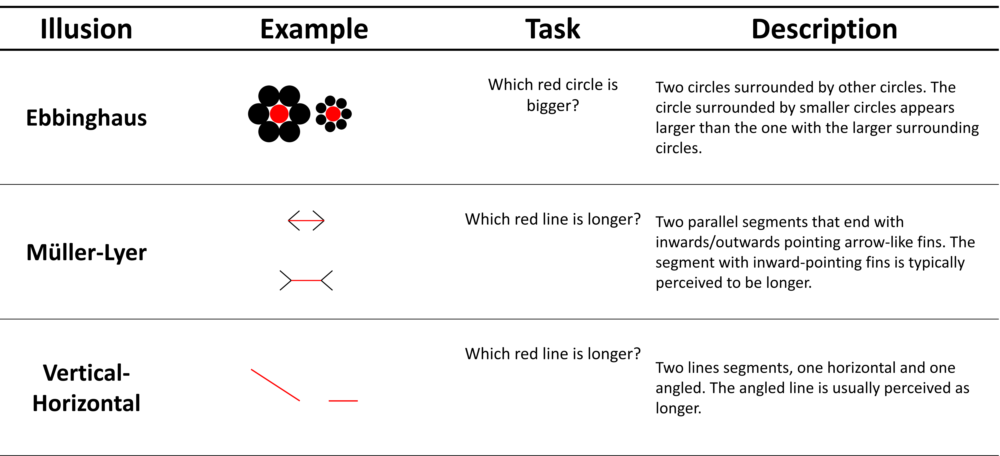
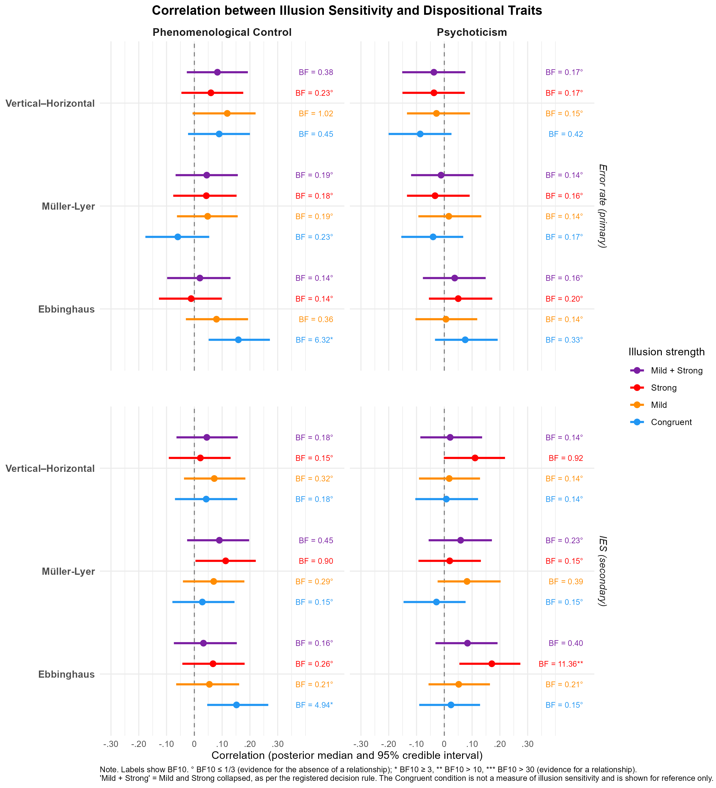
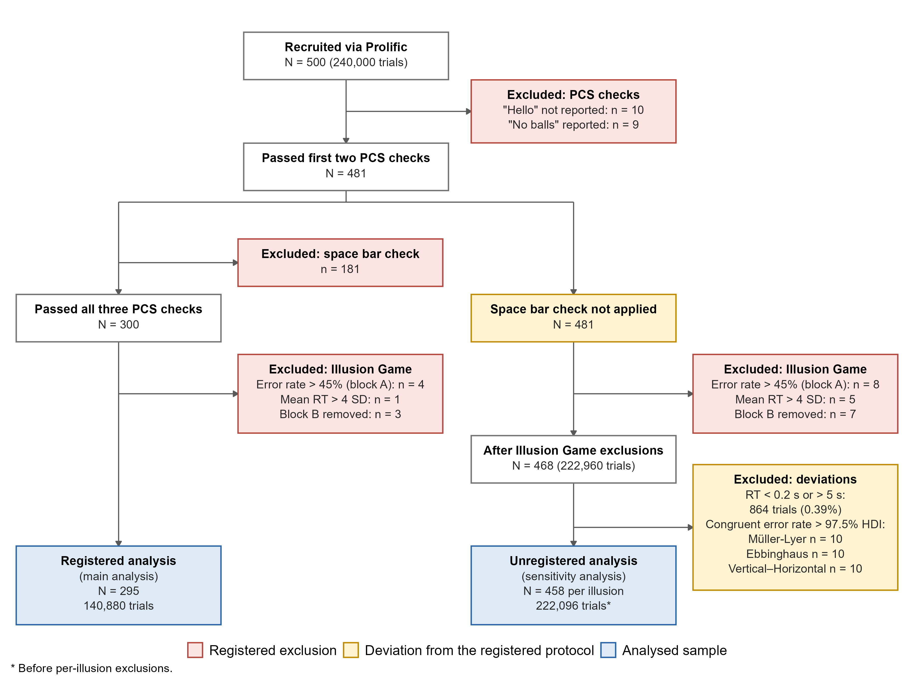
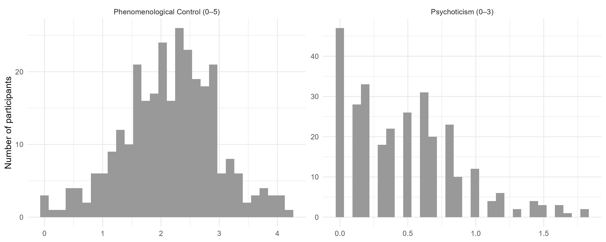

```{r}
#| label: setup
#| include: false

library(conflicted)
library(tidyverse)
library(flextable)
library(ftExtra)
library(officer)
library(knitr)

conflicts_prefer(dplyr::filter, .quiet = TRUE)
conflicts_prefer(flextable::separate_header, .quiet = TRUE)
```

Visual Illusions are an interesting type of stimuli highlighting the ease with which our phenomenological conscious experience can become dissociated from physical reality. 
Their robust and reliable effect makes them useful stimuli to explore how perception is constructed and shaped, and several theoretical models have been put forth to explain how they work. 
In particular, illusions have been reframed using a predictive coding account of perception [e.g., @notredame2014; @nour2015perception] in which the brain optimally combines, using some flavour of Bayesian inference, perceptual inputs with prior knowledge to make sense of ambiguous environments [@friston2010].

Such computational model(s) propose to conceptualize illusions as stimuli providing weak or conflicting sensory evidence [@sundareswara2008; @gershman2012] that bias perception toward prior knowledge. 
In other words, the weight of priors, in the form of perceptual knowledge about the world (e.g., internalized rules of perspective) is amplified when the sensory input is confusing. 
For instance, in the Müller-Lyer illusion, we "compute" the two (actually identical) lines as being of different lengths because the line flanked with converging fins is misinterpreted as being further away [@notredame2014]. 
In this context, measuring sensitivity to illusion can be operationalized as indexing the parameters of the Bayesian inference process (e.g., prior precision).

These accounts also provide a compelling framework to explain existing findings reporting interindividual variability in the sensitivity to illusions. 
Indeed, several studies suggest a potential link with psychopathology, in particular schizophrenia [@costa2023] and autism [@gori2016], in which the reported lower sensitivity to illusions has been attributed to a diminished influence of top-down processes such as prior knowledge [@mitchell2010] and a greater emphasis on (i.e., precision of) sensory information [@palmer2017]. 
Evidence beyond psychopathology also suggests variability in the general population, potentially correlated with personality traits such as agreeableness and honesty-humility [@makowski2023], as well as cognitive abilities [@shoshina2014].

However, the exact nature of this interindividual variability and its potential origin remains unclear. 
The somewhat mixed evidence in the literature regarding its generalizability and strength could be related to the variety of the paradigms used and the type of processes being mobilised [@makowski2021]. 
Indeed, traditional methods frequently focus on participant's experience by prompting them to assess the difference between two identical targets, estimate the target's physical properties, or adjust the targets to match a reference stimulus [@todorovic2020]. 
Relying on metacognitive judgments about one's subjective experiences adds an additional layer to the measure that might not be desired when attempting to measure illusion sensitivity. 
Moreover, paradigms often face challenges in diversifying the illusory effects (i.e., using multiple stimuli to experimentally manipulate the strength of the illusion) and the illusion types (i.e., using various illusions, such as Müller-Lyer, Ebbinghaus, Delboeuf which might rely on a different admixture of mechanisms), hindering the potential of obtaining a comprehensive, valid, and reliable measure of illusion sensitivity.

The "Illusion Game" paradigm [@makowski2023] has been recently developed to measure illusion sensitivity to various illusion types through its behavioural impact (on response time and error rate) in a perceptual decision task (where participants have to respond as fast as possible; e.g., "which of the left or right circles is bigger"). 
The stimuli for different classical illusions are created using the *Pyllusion* software [@makowski2021], which allows researchers to modulate the strength of the illusion as a continuous dimension, independently from the difficulty of the perceptual task. 
This paradigm, inspired by psychophysics, lends itself to the computational modelling of illusion sensitivity through its interference effect —an effect that disrupts an individual's ability to accurately discriminate between perceptual stimuli.
This approach aims to bypass some of the metacognitive processes involved in other paradigms, offering a more direct and objective measure of how illusions influence perceptual judgment.

Interestingly, the fact that inter-individual variability in illusion sensitivity seems to persist in this task suggests that it is not solely explained by metacognitive ability differences, and gives rise to the following question: is the variability in illusion sensitivity related to low-level perceptual processes (e.g., baseline precision of perceptual priors), or rather to the ability to actively control and "resist" the illusion in order to achieve the task at hand (higher-level modulation of the perceptual inference parameters). 
If the latter is true, then illusion sensitivity measured in contexts with strong task-demand characteristics, e.g., in paradigms where participants' performance is explicitly or implicitly assessed (i.e., where there is an incentive to downplay the illusion effect) might correlate with one's ability to alter one's subjective experience following suggestions - a mechanism referred to as "phenomenological control".

The idea that we are endowed with the potential to unconsciously alter our subjective experience and distort reality - even momentarily - to meet the goals at hand is not novel. 
While this phenomenon has been historically often studied under the label of "hypnotisability" - the tendency to alter our conscious experience to match external demands [@lush2021], the term "phenomenological control" (PC) has been recently introduced to disconnect this concept from the potentially negative associations with hypnosis and the misconception that a hypnotic context is necessary for responding to imaginative suggestions [@dienes2022].

To encourage the empirical exploration of our ability and tendency to alter our phenomenological experience and further accelerate investigations away from the hypnotic context, @lush2021 adapted the Sussex-Waterloo Scale of Hypnotisability [SWASH, @lush2018] by removing all its references to hypnosis, to measure trait phenomenological control. 
This newly developed phenomenological control scale (PCS) consists of 10 imaginative suggestions followed by subjective ratings for each suggestion and has demonstrated validity in online experiments [@lush2022].

Interestingly, @lush2022 did test for a relationship between PC and illusion sensitivity using the Müller-Lyer illusion (in which the arrangement of the arrowheads flanking two lines makes them appear as having different lengths), and reported evidence in favour of an absence of correlation between the two measures. 
This finding was interpreted as indicative of the cognitive impenetrability of illusions, implying that the effect is driven by low-level processes and therefore not influenced by top-down mechanisms such as PC. 
Note that both prior-knowledge and phenomenological control are considered top-down processes, but the cognitive impenetrability hypothesis suggests that the processes at stake for the illusions happen at a lower- encapsulated- level (in the form of *perceptual* priors).

The goal of this study is thus to replicate the results from @lush2022 pointing to an absence of a relationship between phenomenological control and illusion sensitivity, by generalising them to a different illusion paradigm that encompasses other illusion types.
Additionally, **we also explored** the relationship between psychoticism, as a proxy for schizophrenia, and illusion sensitivity to assess the potential impact of lower-level effects—such as weak priors observed in individuals with schizophrenia [@costa2023]—on sensitivity to illusions.**
**These analyses may offer evidence clarifying whether inter-individual variability in illusion sensitivity is driven by lower-level perceptual mechanisms or higher-level cognitive processes (@tbl-DesignTable).

```{r}
#| tbl-cap: "Study Design Table"
#| label: tbl-DesignTable
#| apa-twocolumn: true

question <- c("Question", "Hypothesis", "Sampling Plan", "Analysis Plan", "Rationale for Deciding the Sensitivity of the Test", "Interpretation Given Different Outcomes", "Theory That Could Be Shown Wrong by the Outcomes")
answer <- c("Is there a correlation between trait phenomenological control (PC) and visual illusion (VI) sensitivity? Additionally, is there a relationship between VI sensitivity and the psychoticism facet of the PID-5, as a proxy for schizophrenia-related traits?", "In line with Lush et al. (2022), we hypothesise that there will be evidence supporting the absence of a relationship between PC and VI sensitivity. Based on Makowski et al. (2023) and prior work on weak priors in schizophrenia, we hypothesise that higher psychoticism scores will be negatively associated with VI sensitivity.", "The goal is to recruit around 500 adult English speakers using Prolific. This sample size is based on the ones used in Lush et al., 2021 and Lush et al., 2022 that we aim at replicate.", "Bayesian correlations will be conducted using the BayesFactor::correlationBF() function, with a medium prior (r-scale = 1/3), separately for: 1) PC scores and VI sensitivity (error rate and IES), across all three illusion types; and 2) Psychoticism facet scores from the PID-5 and VI sensitivity scores, across all three illusion types.", "For the PC–VI sensitivity relationship, we will interpret BF₁₀ ≤ 1/3 as evidence against a relationship, in line with Lush et al. (2022). For the psychoticism–VI sensitivity relationship, BF₁₀ > 3 will be interpreted as evidence supporting a relationship, following findings by Makowski et al. (2023).", "If there is no evidence for a PC–VI relationship across all three illusions, it would support the hypothesis that VI sensitivity is independent from PC. If a negative association is found between psychoticism and VI sensitivity, it may suggest a low-level perceptual basis for inter-individual differences in illusion sensitivity.", "The cognitive impenetrability of visual illusions, which posits that illusion sensitivity is driven solely by low-level processes and is not influenced by top-down mechanisms such as phenomenological control. Conversely, a lack of association with psychoticism would challenge the view that low-level perceptual alterations underlie illusion sensitivity in non-clinical populations.")

# join variables to create dataframe
study_design_df <- data.frame(question, answer)

## study design table
study_design_table <- flextable::flextable(study_design_df)
study_design_table <- set_table_properties(study_design_table, width = 1, layout = "autofit")
# study_design_table <- set_caption(study_design_table, caption = "Study Design Table")
study_design_table <- delete_part(x = study_design_table, part = "header")
study_design_table <- bold(study_design_table, j = "question", bold = TRUE, part = "body")
study_design_table <- theme_apa(study_design_table)

study_design_table
```

# Methods

## Participants

Five hundred **adult English speakers** (Mean age = 38.6, SD = 13.1, range: [18, 75], 49.4\% of women) were recruited via Prolific (www.prolific.com) and completed the study on a desktop device.^[**Eligibility was implemented using Prolific's screening filters for participants whose first or primary language was English, which departs from the Stage 1 description (see Deviations From Registration).**]
Out of these participants,  2.8\%  reported having a doctoral degree, 18.2% masters degree, 49.6\% a bachelors degree, 27.4\% a high school degree and 2%  other qualifications. 
Participants were first presented with an explanatory statement and **the consent form**, and could proceed by pressing a button to confirm they **had** read and understood the information. This study has been approved by the ethics board of the School of Psychology of the University of Sussex (ER/ASF25/5).

Following the **exclusion steps (see Results and @fig-s1), 295 participants (Mean age = 38.1, *SD* = 12.9, 48.8\% women) were retained in the registered analysis.**
**Sensitivity analyses addressing deviations from the registered protocol were conducted on a larger sample of 468 participants (Mean age = 38.7, *SD* = 13.2, 48.7\% women), of whom 458 were analysed for each illusion (see Deviations From Registration).**

## Procedure

The experiment's setup follows the born-open principle [@deleeuw2023], and all its related material is available at **https://github.com/RealityBending/IllusionGamePhenomenologicalControl**. The online experiment, implemented entirely using *JsPsych* [@de2015jspsych], has its code stored on GitHub and leverages the power of the platform to host the experiment for free. 
Participant’s raw data files (containing identifiers) were stored in a private OSF repository, but **anonymized using a publicly available preprocessing script.** 
The resulting anonymized data, and the analysis reports, are available, ensuring the transparency and reproducibility of all the analysis steps.

Following the informed consent, participants were presented with demographic questions (gender, education level, age, and ethnicity). 
Although these variables **were not directly** analyzed in the current study, they **were** used to provide a detailed and thorough description of the sample and **to maximize** data reusability.
Participants then underwent the Phenomenological Control Scale (PCS) and the Illusion Game task (IG) in a counterbalanced order.

### Phenomenological Control Scale (PCS)

Participants were asked to put on their headphones and await further auditory instructions. 
The PCS procedure started with a recorded introduction explaining that a series of tests would be applied to evaluate how experiences can be created through imagination, followed by 10 suggestions in a fixed order [see @lush2021], such as "now extend your arms ahead of you, with palms facing each other, hands about a foot apart" and "as you sit comfortably in your chair with your eyes closed, a picture of two balls will be displayed on the computer screen". 
Once the 10 suggestions were completed, participants were asked to rate their subjective experiences and response to each suggestion on a 6-points Likert scale (from 0-5).
The Phenomenological control score **was** computed by averaging the scores from the 10 scales.

### Illusion Game

The Illusion Game task used in the current study is an adaptation of the one used in @makowski2023 to make it shorter, in which participants must make perceptual judgments (e.g., "which red line is the longer") as quickly and accurately as possible. It included 3 illusion types, namely Ebbinghaus, Müller-Lyer, and Vertical-Horizontal (see @fig-illusionexample). In the original Illusion Game, 10 visual illusions were presented in two sets, following a practice trial, and separated by two short questionnaires.
Participants completed a total of 1,340 trials, with the experiment lasting approximately **55 minutes.**
In the current procedure, only three illusions were used, selected based on the original study's findings that these illusions most strongly contribute to illusion sensitivity.

```{r}
#| warning: false
#| label: fig-illusionexample
#| apa-twocolumn: true  # A Figure Spanning Two Columns When in Journal Mode
#| out-width: "100%"
#| fig-cap: "The study involved three visual illusions, in which participants were instructed to respond as quickly as possible without making errors. Each illusion included two manipulated parameters: strength (e.g., the angle of the outward- or inward-pointing arrow-like fins in the Müller-Lyer illusion) and difficulty (e.g., the difference in line lengths in the Müller-Lyer illusion)."


```

The procedure encompassed 2 sets of 80 trials for each illusion type, preceded by a practice trial for each illusion. 
Each set included, in a random order, the 3 blocks of illusion types, in which trials were separated by a fixation cross, temporally (uniformly sampled duration of 500 - 1000ms) and spatially jittered (around the centre of the screen in a radius of a 1 cm) to attenuate its potential usefulness as a reference point. 
After each illusion type block, an arbitrary score was presented (computed as a scaled Inverse Efficiency Score) as a gamification mechanism to increase motivation to perform to the best of one's abilities. 
To mitigate for the potential variability in the speed/accuracy trade-off, the instructions emphasized with equal weight to be fast and to avoid errors.

For each illusion type, two continuous dimensions were orthogonally manipulated namely task difficulty and illusion strength, so that each trial corresponds to a unique combination, providing an objectively correct answer for each trial.
The use of these manipulations allows concise, standardised reporting of illusion parameters and ensures our stimuli are fully reproducible [see @makowski2021].

Task difficulty corresponds to the difficulty of the perceptual decision (e.g., if the task is to select the longest red line, task difficulty corresponds to how the lines are objectively different).
Illusion strength corresponds to the degree to which the illusion elements (e.g., the black arrow lines in Müller-Lyer) are interfering with the aforementioned task. 
Note that the illusion effect can be either “incongruent”, making the task more difficult by biasing perceptual decisions toward the incorrect response or “congruent”, making the task easier by biasing decisions toward the correct response (e.g., in the Müller-Lyer illusion, if the outwards-facing arrowheads are placed on the longer line, identifying which line is the longest becomes easier).
Participants responded with a key arrow (left vs. right; or up vs. down), and their reaction time (RT) and accuracy were recorded.

Visual illusion sensitivity was measured as the average error rate in the incongruent condition, and separately for the 3 illusion types. 
Although the error rate is arguably a crude score, which does not take into account the effect of varying illusion strength, the interaction with task difficulty and the possible adjustments in response strategy (speed-accuracy trade off), it is also the most simple and easy to reproduce, hence its usage as our primary outcome for the current registered report. 
As a secondary exploratory outcome, the Inverse Efficiency Score [IES; @townsend2014methods] was computed. This metric incorporates both speed and accuracy by dividing the mean reaction time of correct responses by the proportion of correct responses, separately for each illusion.

The two sets of 3 illusion blocks were separated by 2 short questionnaires acting as a break, namely the IPIP-6 [@sibley2011mini], measuring 6 personality traits with 24 analogue scales items, and the PID-5 [@krueger2011], measuring 5 maladaptive personality traits with 25 Likert scales items. 
These questionnaires were included as a way of providing a break between the two cognitively taxing blocks and maintain paradigmatic consistency with previous studies [@makowski2023]. 
Additionally, the psychoticism subscale of the PID-5 was used to examine the correlation between maladaptive traits and illusion sensitivity, evaluating the existence of the link proposed in previous studies [@costa2023].

## Data Analysis

The phenomenological control scale **included** several attention checks to identify problematic participants.
The task **consisted** of various auditory and visual exercises; at the outset, participants **heard** a voice say “Hello” and **were** asked to select the corresponding phrase from multiple options (i.e., “Hello”, “Goodbye”, “How are you”, “Thank you”).
Selecting an incorrect response **indicated** inattention to auditory stimuli.
In a subsequent exercise, participants **were** instructed: “Open your eyes. You will see only two balls on the screen… just two balls”.
However, three differently coloured balls **were** displayed.
If a participant **selected** the response “No Balls Were Presented”, it **suggested** they failed to attend to both the auditory instruction and the visual stimuli.
In another task, participants **were** instructed to press the spacebar six times.
Pressing it fewer than five times within the allotted time **indicated** a failure to follow the auditory instructions.
Participants who **failed** any one of these **were to be** excluded from further analysis **(see Deviations From Registration)**.
Finally, the reliability of the PCS **was** assessed by computing Cronbach's alpha of its items [@cronbach1951coefficient].

Outliers in the Illusion Game **were** identified based on participants’ performance.
Specifically, any participant exhibiting an error rate greater than 45% for any illusion type **was** considered to be responding at chance level (i.e., randomly) and flagged accordingly.
If this level of performance **occurred** in the first block, the entire participant **was** excluded from analysis, as it suggests a failure to properly engage with the task.
However, if the elevated error rate **was** observed only in the second block, this **was** interpreted as a loss of engagement or motivation (e.g., boredom due to task repetition).
In such cases, only the second block **was** discarded, allowing for estimation of illusion sensitivity based on the valid data from the first block, albeit with reduced precision.
To mitigate the risk of confounding effects driven by extreme speed or accuracy strategies, participants whose **mean RT was slower than** the group average [RT > 4 SD above the mean, based on @makowski2023] **were** excluded from the analysis.
After removing problematic participants and trials, the outcome measures (PC and VI sensitivity scores) **were** computed.

To assess whether the illusions functioned as expected, stimuli **were** categorized into three groups: Strong Illusion Strength & Incongruent, Mild Illusion Strength & Incongruent, and Congruent.
The two outcome measures—error rate and IES—**were** computed separately for each illusion and each illusion strength group.
To evaluate differences between these conditions, two Bayesian t-tests **were** conducted: one comparing the Congruent and Mild conditions, and the other comparing the Mild and Strong conditions.
**Evidence ($BF_{10} > 3$) for** differences in either IES or error rate across these comparisons **was** taken as evidence that the illusions operated as intended.

Next, to determine whether the Mild and Strong Illusion Strength groups **could** be collapsed for further analysis, Bayesian correlations **were** computed between them for each illusion and outcome measure.
If these correlations **were** sufficiently high [*r* > .50, @cohen2013statistical], the groups **were** collapsed and outcomes recomputed across all relevant trials  (i.e., by averaging across these groups).
If not, the groups **were** analysed separately.
This step **was** necessary because reaction time may not have a linear relationship with illusion strength [@makowski2023], and collapsing the data without this check may obscure meaningful differences.
Finally, reliability analyses **were** conducted on all resulting indices, with Cronbach’s alpha used to evaluate internal consistency across the three illusion types.

Bayesian correlations **were** then computed between PCS and illusion sensitivity scores - with the resulting IES and error rate indices.
Following @lush2022, we **expected** to collect evidence against ($BF_{10} \leq 1/3$) a relationship between PCS and VI sensitivity.
Additionally, Bayesian correlations **were** computed between maladaptive trait facets and illusion sensitivity scores.
Based on prior research [@makowski2023], we **expected** to find evidence (**$BF_{10} \geq 3$**) supporting a **(negative)** relationship between the psychoticism facet of the PID-5 and illusion sensitivity.
**Bayes factors between 1/3 and 3 were interpreted as inconclusive.**

All Bayesian analyses **were** conducted using the *BayesFactor* package [@BayesFactor].
For correlations, a medium shifted beta prior **was** applied (r-scale parameter set to  1/3), as recommended by @morey2018baysefactor, providing a balanced approach to estimating effect sizes, without placing undue weight on larger effect sizes or artificially inflating evidence for the null hypothesis.
For t-tests, the *ttestBF* function **was** used with a medium Cauchy prior on the standardised effect size (r-scale = √2⁄2), **the default in the BayesFactor package.**

Data analysis **was** carried out using R, using *tidyverse* [@tidyverse] and *easystats* [@easystats; @parameters; @correlation; @bayestestR; @datawizard].
The analysis script and additional information are available at **https://github.com/RealityBending/IllusionGamePhenomenologicalControl**.
**Departures from this registered plan are reported in the Results as deviations.**
**Their combined and individual effects on the results were evaluated in sensitivity analyses (@tbl-s1).**

# Results

## Data Exclusion 

### Registered Exclusions 

**Of the 500 recruited participants, 19 failed the first two PCS attention checks (10 did not report hearing “Hello”; 9 reported that no balls were presented), and 189 failed the space bar check, 181 of whom had passed the first two checks (see Deviations From Registration). Of the 300 participants who passed all three checks, in line with the registered protocol, 4 participants with an error rate above 45% for any illusion type in the first block were fully excluded, 3 participants exceeding this threshold only in the second block had that block removed (these participants were retained), and 1 participant whose mean RT exceeded the group mean by more than 4 SD was fully excluded. This left 295 participants for the fully registered analysis. The full sequence of exclusions is shown in @fig-s1.**

### Deviations From Registration

**In addition to a discrepancy between the recruitment criterion and its description in the Stage 1 manuscript (see Participant Eligibility), we identified three issues during analysis that could affect the validity of the registered exclusions: an attention check that was failed by a disproportionate number of participants, trials with implausible response times, and a small number of participants who appeared to have misunderstood the task instructions.**
**These three issues are described below and were addressed together in an unregistered analysis, used as a sensitivity analysis (see Sensitivity Analyses).**

#### Participant Eligibility

**The Stage 1 manuscript specified that adult native English speakers would be recruited. Eligibility was implemented using Prolific's screening filters, which admitted participants whose first or primary language was English; the Stage 1 wording did not reflect this intended recruitment criterion and was an error in the Stage 1 manuscript. As a result, 59 of the 500 recruited participants (43 of the 295 participants in the registered analysis) did not report English as their first language. The effect of this deviation was evaluated by restricting the registered analysis to native English speakers (N = 252; see Sensitivity Analyses and @tbl-s1 and @tbl-s1-bf).**

#### Phenomenological Control

The registered protocol specified that participants failing any of **three** attention checks in the PCS would be excluded.
**The first two checks were failed by 19 participants (3.8%), whereas the third one was failed by 189 participants (37.8%). Most failures (177 of 189) recorded no presses at all, which argues against dropped key presses (which would produce partial counts). Most of these participants (181 of 189) passed the other two checks, and in the sample used for the sensitivity analyses (N = 468), the scores of participants who failed the space bar check on the remaining PCS items were not lower than those of participants who passed it (*M* = 2.49 vs. 2.28; $BF_{10} = 2.90$), suggesting that failures did not reflect general inattention. Instead, the failure rate may reflect how the check was implemented: although the auditory instruction, delivered with eyes closed, stated that the “PLEASE WAIT” message would appear “a little later”, the screen appeared as soon as the recording ended (i.e., as participants were told to open their eyes), disappeared after 10 seconds, and only recorded presses made while it was displayed. Participants who were still reorienting after opening their eyes, or who pressed during the instruction, would therefore have been recorded as not pressing at all.**

**We therefore repeated the analyses without the space bar check as part of the unregistered analysis. In this sample (the 481 participants who passed the first two PCS checks), the registered Illusion Game criteria fully excluded 8 participants on the basis of error rate and 5 on the basis of RT (none of whom were flagged by both criteria), and removed the second block of 7 participants (who were retained), leaving 468 participants.**

#### Illusion Game

**Two unregistered exclusions were applied to the Illusion Game data in the unregistered analysis. First, the Stage 1 protocol referred to the removal of problematic trials but did not specify a criterion. Trials with response times below 0.2 s or above 5 s were therefore excluded as implausible [@theriault2024], removing 864 trials (0.39% of the data; 298 faster than 0.2 s and 566 slower than 5 s).**

**Second, during data inspection, a small number of participants showed very high error rates in the congruent condition, where the illusion makes the task easier and errors are typically rare. These patterns are more consistent with a misunderstanding of the instructions (e.g., selecting the smaller instead of the larger circle) than with illusion sensitivity, as greater susceptibility to the illusion should lead to fewer, not more, errors in this condition. Participants whose congruent error rate for a given illusion lay above the 97.5% highest density interval (HDI) of its distribution (computed after the removal of these trials) were therefore excluded from the analyses of that illusion only (10 participants, 2.14%, for each illusion), leaving 458 participants per illusion.**

## Manipulation Check

Bayesian paired-samples *t*-tests **in the registered analysis (N = 295)** revealed extreme evidence for differences between **adjacent** illusion strength conditions, with performance decreasing as illusion strength increased across all illusion types and outcome measures ($BF_{10} > 1000$). For all three illusions (Ebbinghaus, Müller–Lyer, Vertical–Horizontal), error rates and IES were **lower** in the Congruent relative to Mild condition, and lower in the Mild relative to Strong condition, consistent with the expected effect of illusion strength (see @tbl-tablemeans). 

```{r}
#| label: tbl-tablemeans
#| warning: false
#| apa-twocolumn: true
#| disable-apaquarto-processing: true
#| tbl-cap: "Mean and standard deviation of error rate and IES for each illusion type and strength condition in the registered analysis (N = 295). All differences between adjacent illusion strength conditions showed extreme evidence ($BF_{10} > 1000$)."


table <- readRDS("../../analysis/figures/table1_raw.rds")
names(table) <- str_replace(names(table), "IES ", "IES - ") |> 
  str_replace("Rate ", "Rate - ")

table |>
  datawizard::data_rename("Illusion_Type", "Illusion") |>
  flextable::as_flextable()|>
  # flextable::add_footer_lines(
  #   values = flextable::as_paragraph(flextable::as_i("Note. "),"These values present mean and standard deviations.")) |>
  flextable::set_table_properties(width = 1, layout = "autofit") |>
  flextable::fontsize(size = 10)
  
```


## Score Consistency

The 10 items forming the PCS score yielded acceptable consistency ($\alpha = 0.78$). **PCS scores (possible range 0-5) had a mean of 2.16 (*SD* = 0.80, range: 0.00–4.20), and psychoticism scores (possible range 0-3) a mean of 0.48 (*SD* = 0.40, range: 0.00–1.80), with a positively skewed distribution (skewness = 0.85; @fig-s2).**

For the illusion scores, the registered plan was to first evaluate **whether the Mild and Strong illusion strength conditions could be collapsed, based on the correlation between them for each illusion and outcome (collapsed if *r* > .50; @tbl-s2)**.
**Error rates were collapsed for all three illusions (Müller-Lyer: *r* = .67; Ebbinghaus: *r* = .76; Vertical–Horizontal: *r* = .72).**
**IES were collapsed for the Müller-Lyer (*r* = .55) and Ebbinghaus illusions (*r* = .54), but analysed separately for the Vertical–Horizontal illusion (*r* = .43).** **Analyses with Mild and Strong kept separate for all scores are reported as exploratory analyses.**

Consistency analyses between the 3 illusions were conducted as registered, using Cronbach’s alpha. Error rate consistency was low (Mild: **$\alpha = .33$**; Strong: **$\alpha = .06$**; collapsed: **$\alpha = .19$**), whereas IES **consistency** was mixed (Mild: **$\alpha = .83$**; Strong: **$\alpha = .17$**; **collapsed: $\alpha = .74$**), overall providing no evidence for combining the scores of the 3 illusions.


## Correlations

### Registered Analysis

Bayesian correlations were conducted to assess the relationship between illusion sensitivity (**error rate as the primary outcome and IES as the secondary outcome**) and both PCS scores and the psychoticism facet of the PID-5. **All registered tests are reported in @tbl-correlations and displayed in @fig-corr.**

**Of the 14 registered tests, 10 met the threshold for evidence for the null ($BF_{10} \leq 1/3$), 4 were inconclusive, and none supported a relationship.**
**For the primary outcome (error rate), the correlation between PCS and illusion sensitivity provided evidence for the null for the Müller-Lyer ($\rho = 0.04$, $BF_{10} = 0.19$) and Ebbinghaus illusions ($\rho = 0.02$, $BF_{10} = 0.14$), and was inconclusive for the Vertical-Horizontal illusion ($\rho = 0.08$, $BF_{10} = 0.38$).** **For the secondary outcome (IES), 3 of the 4 PCS tests supported the null and 1 was inconclusive (Müller-Lyer, $BF_{10} = 0.45$).**

**The correlations between psychoticism and error rates all supported the null ($BF_{10} = 0.14$–$0.17$), as did 2 of the 4 IES tests, while the other 2 were inconclusive ($BF_{10} = 0.40$ and $BF_{10} = 0.92$).**
**None of the registered tests therefore supported the hypothesised negative association between psychoticism and illusion sensitivity.**

```{r}
#| label: tbl-correlations
#| apa-twocolumn: true
#| tbl-cap: "Registered Bayesian correlations between illusion sensitivity and dispositional traits (registered analysis, N = 295). Mild and Strong conditions were collapsed (Mild + Strong) or analysed separately according to the registered decision rule. ρ = posterior median with 95% credible interval. Evidence: Null = $BF_{10} \\leq 1/3$; Inconclusive = $1/3 < BF_{10} < 3$; Relationship = $BF_{10} \\geq 3$."

readRDS("../../analysis/figures/table_correlations_registered.rds") |>
  mutate(
    Outcome = recode(Outcome, "Error rate" = "Error rate (primary)", "IES" = "IES (secondary)"),
    `ρ [95% CI]` = sprintf("%.2f [%.2f, %.2f]", rho, CI_low, CI_high),
    `BF₁₀` = sprintf("%.2f", BF),
    Evidence = recode(Evidence, "H0" = "Null", "H1" = "Relationship")
  ) |>
  select(Trait, Outcome, Illusion, Condition, `ρ [95% CI]`, `BF₁₀`, Evidence) |>
  flextable::flextable() |>
  flextable::set_table_properties(width = 1, layout = "autofit") |>
  flextable::fontsize(size = 9, part = "all")
```


```{r}
#| warning: false
#| label: fig-corr
#| apa-twocolumn: true  # A Figure Spanning Two Columns When in Journal Mode
#| out-width: "100%"
#| fig-cap: "Bayesian correlations (posterior median and 95% credible interval) between illusion sensitivity and dispositional traits in the fully registered analysis (N = 295). Error rate (primary outcome) and IES (secondary outcome) are shown in separate panels. Labels show $BF_{10}$ (° $BF_{10} \\leq 1/3$; * $BF_{10} \\geq 3$; ** $BF_{10} > 10$; *** $BF_{10} > 30$). 'Mild + Strong' denotes scores collapsed across illusion strength. The Congruent condition is not a measure of illusion sensitivity and is shown for reference only. The corresponding figure for the unregistered analysis is available in the project repository."


```

### Sensitivity Analyses

**The registered analyses were repeated in the unregistered analysis described in Deviations From Registration, which addressed the issues identified during analysis: the space bar check was not applied, and extreme trials and participants with extreme congruent error rates were excluded (N = 458 per illusion).** 
**The registered decision rule for collapsing Mild and Strong was applied separately in this sample, leading to the same decisions except for the IES of the Müller-Lyer illusion, which was analysed separately (*r* = .43; @tbl-s2).**
**The effect of each deviation was also evaluated separately (@tbl-s1; test-by-test Bayes factors in @tbl-s1-bf).**
**Applying the registered criteria without the space bar check (N = 468) led to the same conclusions for the primary outcome. For the secondary outcome (IES), two tests of the Vertical-Horizontal illusion (Mild) were inconclusive rather than supporting the null (PCS: $BF_{10} = 0.38$; psychoticism: $BF_{10} = 0.74$), and one test of the relationship between psychoticism and IES provided evidence for a relationship (Vertical-Horizontal, Strong: $BF_{10} = 3.21$; @tbl-s1-bf), although in the direction opposite to the registered hypothesis.**
**Restricting the registered analysis to native English speakers (N = 252), as specified in the Stage 1 protocol, also led to the same conclusions for the primary outcome, with evidence for the null for all three illusions (Vertical-Horizontal: $BF_{10} = 0.25$).**
**None of these changes altered the conclusions for the primary outcome: in the unregistered analysis, PCS was unrelated to error rates for the Müller-Lyer ($BF_{10} = 0.11$) and Ebbinghaus illusions ($BF_{10} = 0.11$), the evidence for the Vertical-Horizontal illusion remained inconclusive ($BF_{10} = 0.42$), and all psychoticism–error rate correlations supported the null ($BF_{10} = 0.11$–$0.20$).**
**The classification of a few tests of the secondary outcome (IES) lying close to the evidential thresholds varied between versions, but none supported a relationship in the unregistered analysis.**


### Exploratory Analyses

To ensure the robustness of these findings to various analysis decisions, we additionally computed the correlations with variant scores of the illusion game, namely with **Mild and Strong analysed separately for all scores, and with outcomes computed separately for each difficulty level (i.e., Easy and Hard).**
**With Mild and Strong analysed separately, 9 of the 12 PCS correlations supported the null and 3 were inconclusive; across the 36 difficulty-specific PCS correlations, 29 supported the null and 7 were inconclusive.**
**No PCS correlation supported a relationship.**
**For psychoticism, one correlation supported a relationship in both variants: IES for the Ebbinghaus illusion in the Strong condition (Mild and Strong separate: $\rho = 0.17$, $BF_{10} = 11.4$; Easy trials: $\rho = 0.17$, $BF_{10} = 11.2$), which was positive, i.e., in the direction opposite to the registered hypothesis.**
**All other psychoticism correlations supported the null or were inconclusive.**
**Finally, PCS correlated with the error rate ($BF_{10} = 6.32$) and IES ($BF_{10} = 4.94$) in the congruent condition of the Ebbinghaus illusion (@fig-corr); as the congruent condition does not index illusion sensitivity, these correlations were not part of the registered tests and should be interpreted with caution.**

# Discussion

This study aimed to replicate previous findings indicating (1) an absence of a relationship between visual illusion sensitivity and phenomenological control [@lush2022], and (2) the existence of a **negative** relationship between illusion sensitivity and psychoticism [@makowski2023].
**For the primary outcome (error rate), registered Bayesian correlation analyses provided evidence against a relationship between phenomenological control and sensitivity to two of the three illusions tested (Müller-Lyer and Ebbinghaus), whereas the evidence for the third (Vertical-Horizontal) was inconclusive, partly supporting the first hypothesis.**
**For psychoticism, the data favoured the absence of an association with error rates, contrary to the second hypothesis, whereas the evidence for IES was mixed.**
**These conclusions were robust to the data quality issues identified during analysis: an unregistered analysis that addressed them, with a larger sample, did not change any conclusion for the primary outcome.**

<!-- PCS -->
The present findings **partly replicate @lush2022.**
**For the primary outcome, we obtained evidence against a relationship between trait phenomenological control (PC) and sensitivity to the Müller-Lyer and Ebbinghaus illusions, whereas the evidence for the Vertical-Horizontal illusion was inconclusive.**
Crucially, while previous research relied largely on subjective metacognitive judgments, our use of the Illusion Game paradigm extends this null finding to a direct, behavioral measure of perceptual interference. 
This **pattern is consistent with** the cognitive impenetrability of **these illusions under the present task conditions.**
Although both PC and illusion susceptibility can be conceptualized as top-down processes, our results suggest they operate at different levels of the cognitive hierarchy. 
The perceptual priors assumed to drive illusion sensitivity might be organized in a modular and encapsulated fashion. 
Consequently, even individuals with a high capacity to alter their subjective experience in response to goals or expectations (high PC) **do not appear to exert high-level**, goal-directed control over these low-level perceptual inferences. 
In practice, this suggests that the trait capacity to manipulate one’s phenomenology is insufficient to override the behavioural interference **of these illusions**. 
**The inconclusive result for the Vertical-Horizontal illusion, however, indicates that this conclusion cannot be extended to all three illusions tested.**

<!-- Psychoticism -->
In contrast to our registered hypothesis, we found no evidence of an association between visual illusion sensitivity and the psychoticism facet of the PID-5; **for the primary outcome, the Bayes factors favoured the absence of an association rather than being merely uninformative.** 
This result was unexpected, given the literature linking schizophrenia-spectrum traits and schizotypy to reduced susceptibility to visual illusions, a phenomenon often attributed to the reduced precision of perceptual priors within predictive coding frameworks. 
**One possible contributor is the limited variability of psychoticism in our general-population sample: scores were low on average (*M* = 0.48 on a 0–3 scale) and positively skewed, with most participants scoring near the bottom of the scale (@fig-s2).**
**Such a restricted range limits the ability to detect associations.**
However, this discrepancy may **also** be driven by how individual differences were operationalized in the current study. 
For instance, whereas @makowski2023 measured sensitivity across an aggregate of 10 different visual illusions, the current procedure was streamlined to include only three, **and the relationship with psychoticism was analyzed for each illusion individually.** 
**We may therefore have lacked the statistical breadth required to extract a robust, common “illusion sensitivity” factor.** 
Conceptually, we could hypothesize that the task-performance on any single illusion is driven by a combination of illusion-specific factors (e.g., the particular perceptual properties and localized prior-systems engaged by that specific visual configuration) and illusion-general factors (an overarching, trait-level characteristic tapped into during illusory perceptual interference). 
When analyzing specific illusions in isolation, the illusion-specific factors might overweigh the common component, potentially masking associations with broad personality constructs. 
However, this assumption is challenged by the fact that the internal consistency (i.e., the inter-correlation) between the three illusions in our sample was remarkably low, inconsistent at first glance with the notion of a common “illusion sensitivity” factor. This lack of coherence might result from a compounding of issues related to both the low number of illusions, as well as the specific measurement indices utilized.

Indeed, it is important to underline that the above findings and hypotheses are predicated on one critical assumption: that the outcome measures used in the current study (error rate and IES) are valid and sensitive indices to the individual differences in illusion sensitivity. 
Previous studies that successfully detected relationships with personality traits, such as @makowski2023, utilized indices derived from participant-specific parameters extracted from group-level hierarchical Bayesian General Additive Models (GAMs). 
In contrast, the current pre-registered analysis intentionally relied on rather crude summary measures. This critical methodological trade-off regarding how perceptual interference is quantified was adopted as complex computational models, while sensitive, carry **considerable** drawbacks. 
For instance, they are computationally challenging and complex, and the resulting individual indices are not easily reproducible and replicable (as the estimates are inherently dependent on a bespoke parent model estimated from a specific dataset). 
Moreover, they are inherently limited by the appropriateness of the parent model as an accurate representation of the underlying data-generating process, which as noted by @makowski2023, is not yet established. 
In particular, while the GAMs used are great models to describe complex, potentially non-linear, patterns and relationships, they did not account for the interaction between speed and accuracy, which might be an important aspect of illusion-related perceptual interference effects.
But while our chosen summary metrics provided a straightforward, reproducible index of performance, collapsing the variance across task difficulty, illusion strength, and speed-accuracy trade-offs might have stripped away the nuanced resolution required to detect the subtle, low-level individual differences associated with personality-level characteristics.
**The sensitivity of the tests was further limited by the sample size of the registered analysis: applying the registered space bar check reduced the sample from 468 to 295 participants, and the inconclusive results (concentrated in the Vertical-Horizontal illusion and the secondary outcome) may partly reflect this reduced sensitivity rather than evidence for a relationship.**
**Notably, the unregistered analysis, with a larger sample, led to the same conclusions for the primary outcome.**


<!-- Active and goal-directed -->
Another important consideration for contextualizing these findings lies in the specific cognitive demands of the Illusion Game and the distinction between trait and state phenomenological control. 
In our paradigm, participants were explicitly motivated to respond as quickly and accurately as possible, effectively incentivizing them to actively inhibit or "resist" the illusory interference. 
This voluntary, goal-directed attempt to suppress a visual bias likely mobilizes distinct cognitive mechanisms compared to contexts where individuals are simply invited to passively experience or contemplate an illusion. 
In such contemplative settings, individuals might even implicitly magnify the illusory effect for aesthetic or psychological engagement. Furthermore, the present study measured trait phenomenological control, the baseline capacity for altering subjective experience, but did not provide an explicit induction or suggestion to alter the perception of the stimuli (i.e., state phenomenological control). 
**Moreover, while the task instructions provided a clear goal (to respond accurately despite the illusion), they did not provide any strategy for achieving it, and motivation to overcome an illusion is distinct from knowing how to do so.**
**The present results therefore concern the relationship between trait phenomenological control and illusion susceptibility, and do not speak to whether state-dependent interventions (e.g., a specific suggestion or strategy) could confer behavioural control over these illusions.**
**Future studies could test whether explicitly providing potentially effective strategies, such as those shown to reduce Stroop interference [@palfi2022], reduces susceptibility to these illusions, and whether the present instructions are sufficient to reduce interference in tasks in which cognitive penetration is known to be possible.**
Typical PC tasks assess the ability to generate or facilitate a suggested experience (e.g., feeling a heavy arm), whereas our task required the suppression of a bottom-up perceptual signal. 
It remains an open question whether a strong, context-specific suggestion (e.g., "you will see the lines exactly as their physical length dictates") could mobilize state phenomenological control sufficiently to penetrate these encapsulated perceptual priors. 
Consequently, our results should **not** be over-generalized and are best framed specifically as suggesting that high *trait capacity* for phenomenological control does not automatically confer an enhanced ability to *actively* inhibit **these** perceptual illusions under strict, performance-driven task demands.


<!-- Summary, and future studies  -->
In summary, the present study **suggests that sensitivity to the Müller-Lyer and Ebbinghaus illusions is largely unrelated to** our trait-level capacity to alter subjective phenomenology. 
**Importantly, three illusions are not a representative sample of visual illusions, and their low inter-correlation in the present data suggests that performance on each of them is largely driven by illusion-specific mechanisms.**
**Our conclusions therefore apply to the illusions for which evidence for the null was obtained, rather than to visual illusions in general.**
However, our findings also highlight a critical methodological bottleneck in the study of perceptual individual differences. 
The lack of correlation between illusion sensitivity and psychoticism, coupled with low inter-illusion consistency, suggests that simple summary metrics derived from a small subset of illusions are insufficient to capture broad perceptual traits. 
Future research aiming to map low-level perceptual priors onto higher-order personality or psychopathological constructs must bridge the gap between reproducibility and modeling sensitivity. 
This could involve utilizing computational frameworks that explicitly model the speed-accuracy trade-off, such as Drift Diffusion Models (DDMs), to disentangle true perceptual bias from response impulsivity. 
Furthermore, developing standardized, multi-illusion batteries will be essential for successfully isolating a common, trait-level "illusion sensitivity" factor from the noise of illusion-specific variance. 
Until such high-resolution, reliable metrics are established, the subtle links between subclinical maladaptive traits and predictive coding parameters might remain difficult to capture.


# Data Availability

All study materials, experiment code, data and analysis code are available on GitHub at **https://github.com/RealityBending/IllusionGamePhenomenologicalControl. An archived copy of the repository is available on Zenodo at https://doi.org/10.5281/zenodo.23943901.**

This study was pre-registered as a Registered Report (https://osf.io/kvjnm) following Stage 1 in-principle acceptance on the 5/12/2025. 

# Acknowledgments

We would like to thank Oliver Collins for his help in the last mile of this project, An Shu Te for her help in setting it up, Ryan Scott for his help in implementing the phenomenological control scale, and Zoltan Dienes for his input, feedback and guidance.

# Conflict of Interest Disclosure

**The authors of this article declare that they have no financial conflict of interest with the content of this article.**

\pagebreak

# References

<!-- References will auto-populate in the refs div below -->

::: {#refs}
:::

\pagebreak

# Supplementary Materials

```{r}
#| warning: false
#| label: tbl-s1
#| apa-twocolumn: true  # A Figure Spanning Two Columns When in Journal Mode
#| out-width: "100%"
#| tbl-cap: "Number of registered tests supporting the null/ inconclusive/ supporting a relationship under each version of the analysis"


# Rows grouped by what they are compared with (versions from the initial submission are not shown)
s1_labels <- tribble(
  ~Analysis, ~Group, ~Label,
  "Fully registered", "Main analysis", "Registered analysis",
  "Registered, native English speakers only", "Registered analysis with one deviation", "Native English speakers only",
  "Registered criteria without the space bar check (no other deviation)", "Registered analysis with one deviation", "Space bar check not applied",
  "Unregistered", "Unregistered analysis (all deviations)", "All deviations",
  "Unregistered without the trial-level RT filter", "Unregistered analysis (all deviations)", "Without the trial exclusions",
  "Unregistered without the HDI exclusion", "Unregistered analysis (all deviations)", "Without the HDI exclusion",
  "Registered, Mild and Strong not collapsed (exploratory)", "Exploratory", "Mild and Strong not collapsed"
)
outcomes <- c("PCS × Error rate", "Psychoticism × Error rate", "PCS × IES", "Psychoticism × IES")
n_tests <- function(x) sapply(strsplit(x, " / "), function(v) sum(as.numeric(v)))

s1 <- readRDS("../../analysis/figures/table_sensitivity.rds")
s1 <- merge(s1, s1_labels, by = "Analysis")
s1 <- s1[match(s1_labels$Analysis, s1$Analysis), ]
s1$N <- as.character(s1$N)
s1$Tests <- as.character(Reduce(`+`, lapply(outcomes, function(o) n_tests(s1[[o]]))))

# One heading row per group, followed by its analyses
rows <- list()
group_rows <- c()
for (g in unique(s1_labels$Group)) {
  rows[[length(rows) + 1]] <- tibble(Label = g)
  group_rows <- c(group_rows, sum(sapply(rows, nrow)))
  rows[[length(rows) + 1]] <- s1[s1$Group == g, c("Label", "N", "Tests", outcomes)]
}
tab <- bind_rows(rows) |>
  mutate(across(everything(), ~ replace_na(.x, "")))

flextable::flextable(tab) |>
  flextable::set_header_labels(Label = "Analysis", `PCS × Error rate` = "PCS", `Psychoticism × Error rate` = "Psychoticism",
                               `PCS × IES` = "PCS", `Psychoticism × IES` = "Psychoticism") |>
  flextable::add_header_row(values = c("", "Error rate (primary)", "IES (secondary)"), colwidths = c(3, 2, 2)) |>
  flextable::merge_h_range(i = group_rows, j1 = 1, j2 = 7) |>
  flextable::bold(i = group_rows, part = "body") |>
  flextable::italic(i = group_rows, part = "body") |>
  flextable::padding(i = setdiff(seq_len(nrow(tab)), group_rows), j = 1, padding.left = 12, part = "body") |>
  flextable::align(j = 2:7, align = "center", part = "all") |>
  flextable::add_footer_lines("Note. Each cell gives the number of tests with BF₁₀ ≤ 1/3 (null) / inconclusive / BF₁₀ ≥ 3 (relationship). N is the number of participants analysed (per illusion where it varies). Tests is the number of tests in each version, which varies because the decision rule for collapsing Mild and Strong was applied separately in each sample.") |>
  flextable::set_table_properties(width = 1, layout = "autofit") |>
  flextable::fontsize(size = 9, part = "all")
```

```{r}
#| warning: false
#| label: tbl-s1-bf
#| apa-twocolumn: true
#| out-width: "100%"
#| tbl-cap: "Bayes factors of the registered tests under each version of the analysis"

bf_versions <- c(
  "Fully registered" = "Main",
  "Registered, native English speakers only" = "Native English only",
  "Registered criteria without the space bar check (no other deviation)" = "No space bar check",
  "Unregistered" = "All deviations",
  "Unregistered without the trial-level RT filter" = "Without trial exclusions",
  "Unregistered without the HDI exclusion" = "Without HDI exclusion"
)

bf <- readRDS("../../analysis/figures/table_sensitivity_tests.rds") |>
  filter(Analysis %in% names(bf_versions)) |>
  mutate(
    Version = factor(bf_versions[Analysis], levels = bf_versions),
    Test = ifelse(Condition == "Mild + Strong", Illusion, paste0(Illusion, " (", Condition, ")")),
    Cell = paste0(sprintf("%.2f", BF), case_when(Evidence == "H0" ~ "°", Evidence == "H1" ~ "*", .default = ""))
  )

# One row per test, one column per version ("—": test not run in this version)
bf_wide <- function(value) {
  bf |>
    select(Trait, Outcome, Test, Version, all_of(value)) |>
    pivot_wider(names_from = Version, values_from = all_of(value), names_sort = TRUE) |>
    arrange(Trait, Outcome, Test)
}
cells <- bf_wide("Cell") |> mutate(across(all_of(unname(bf_versions)), ~ replace_na(.x, "—")))
evidence <- bf_wide("Evidence")
n_per_version <- bf |>
  summarize(N = paste(unique(range(n_Obs)), collapse = "–"), .by = Version) |>
  arrange(Version)

ft <- flextable::flextable(cells) |>
  flextable::set_header_labels(values = setNames(as.list(c("", "", "", paste("N =", n_per_version$N))),
                                                 c("Trait", "Outcome", "Test", as.character(n_per_version$Version)))) |>
  flextable::add_header_row(values = c("Trait", "Outcome", "Test", as.character(n_per_version$Version))) |>
  flextable::add_header_row(values = c("", "Registered analysis", "Unregistered analysis"), colwidths = c(3, 3, 3)) |>
  flextable::merge_v(j = c("Trait", "Outcome")) |>
  flextable::valign(j = c("Trait", "Outcome"), valign = "top", part = "body") |>
  flextable::align(j = 4:9, align = "center", part = "all")

# Shade cells by evidence category
for (v in unname(bf_versions)) {
  ft <- ft |>
    flextable::bg(i = which(evidence[[v]] == "H0"), j = v, bg = "#D6E6F4", part = "body") |>
    flextable::bg(i = which(evidence[[v]] == "H1"), j = v, bg = "#F6C79B", part = "body") |>
    flextable::color(i = which(is.na(evidence[[v]])), j = v, color = "grey60", part = "body")
}

ft |>
  flextable::add_footer_lines("Note. Each cell gives the Bayes factor (BF₁₀) of a registered test. Blue: evidence for the null (BF₁₀ ≤ 1/3, also marked °); orange: evidence for a relationship (BF₁₀ ≥ 3, also marked *); unshaded: inconclusive. —: test not run in this version, because the decision rule for collapsing Mild and Strong led to a different decision in this sample. Under Registered analysis, Main is the main analysis and the other columns apply one deviation to it; under Unregistered analysis, All deviations is the unregistered analysis and the other columns remove one deviation from it. N is the number of participants analysed (per illusion where it varies).") |>
  flextable::set_table_properties(width = 1, layout = "autofit") |>
  flextable::fontsize(size = 8, part = "all")
```


```{r}
#| warning: false
#| label: tbl-s2
#| apa-twocolumn: true  # A Figure Spanning Two Columns When in Journal Mode
#| out-width: "100%"
#| tbl-cap: "Correlations between the Mild and Strong conditions used for the registered decision rule (collapsed if *r* > .50)"


readRDS("../../analysis/figures/table_collapse.rds") |>
  filter(Analysis %in% c("Fully registered", "Unregistered")) |>
  mutate(
    Analysis = recode(Analysis, "Fully registered" = "Registered analysis", "Unregistered" = "Unregistered analysis"),
    Outcome = recode(Outcome, "ErrorRate" = "Error rate"),
    Illusion = recode(Illusion, "MullerLyer" = "Müller-Lyer", "VerticalHorizontal" = "Vertical-Horizontal"),
    r = sprintf("%.2f", r),
    Collapse = ifelse(Collapse, "Yes", "No")
  ) |>
  flextable::flextable() |>
  flextable::set_table_properties(width = 1, layout = "autofit") |>
  flextable::fontsize(size = 9, part = "all")
```


```{r}
#| warning: false
#| label: fig-s1
#| apa-twocolumn: true  # A Figure Spanning Two Columns When in Journal Mode
#| out-width: "100%"
#| fig-cap: "Flow of participants and trials through the registered exclusion criteria (red), the deviations from the registered protocol (yellow), and the resulting analysed samples (blue)"



```


```{r}
#| warning: false
#| label: fig-s2
#| apa-twocolumn: true  # A Figure Spanning Two Columns When in Journal Mode
#| out-width: "100%"
#| fig-cap: "Distribution of PCS and psychoticism scores in the registered analysis (N = 295)"


```
